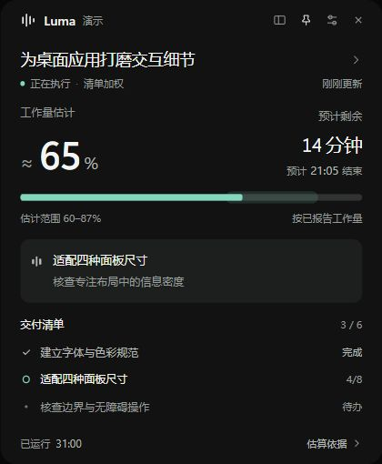

# Luma · Codex 对话进度

A non-invasive Windows companion for Codex, with evidence-weighted progress and local remaining-time forecasts.

独立置顶小面板，关注你选择的一条 Codex 对话。显示工作量估计、当前交付项、时间区间和预计结束时刻。保留有依据的大幅修正；动画只表达状态变化。

## 四种布局

| 布局 | 用途 | 内容 |
| --- | --- | --- |
| [悬浮条](docs/images/ribbon.jpg) | 放在窗口边缘 | 对话、进度、剩余时间与结束时刻 |
| [迷你](docs/images/mini.jpg) | 一瞥了解状态 | 加上当前步骤、运行计时与估算依据 |
| [专注](docs/images/focus.jpg) | 日常工作 | 当前步骤关联执行说明、最近交付和下一步 |
| [完整](docs/images/full.jpg) | 了解来龙去脉 | 全部清单、执行轨迹和完成证据 |

标题栏拖动，图钉切换置顶，布局按钮切换尺寸。点击对话标题选择关注对象；“估算依据”解释当前数据和本机模型表现。支持逐位数字动画、执行轨迹动画，以及系统和应用内的减少动态效果设置。所有截图使用明确标注的合成演示数据。

## 在 Windows 上运行

需要 Python 3.11、Node.js 22+（可选协作插件）和 Microsoft Edge WebView2 Runtime。

在克隆的仓库目录运行：

~~~powershell
py -3.11 -m venv .venv
.\.venv\Scripts\python.exe -m pip install -r requirements.txt
.\.venv\Scripts\python.exe prepare.py
.\Luma.exe
~~~

也可以直接运行：

~~~powershell
.\.venv\Scripts\python.exe app.py
~~~

默认从当前用户的 CODEX_HOME 或 ~/.codex 读取会话。自定义位置：

~~~powershell
.\.venv\Scripts\python.exe prepare.py --codex-home "D:\MyCodex"
~~~

prepare.py 只生成本机启动配置、图标、轻量启动器和本地插件目录。Luma.exe 依赖同目录源码与 Python 环境，不是独立打包的安装程序。首次运行会在后台训练本机时间模型，数据不足时保留“待估算”。

## 进度怎样计算

**清单协作优先。** Codex 按交付项报告权重、状态和具体证据。完成 3/8 个可计数子单元，只获得该项权重的 3/8；仅开始一项工作不加分。范围变化、返工或调整子单元总数需要说明原因。计数不能使用时间、tokens 或工具调用次数。

没有清单时，活动线索只能提供低把握的参考。运行中最高显示 95%；已知仍有未完成项时，即使本轮结束，也保留“仍有待办”。100% 表示本轮结束，不能替代对最终成果的验收。

**剩余时间分两层。** 整轮模型预测 Codex 何时结束。能够观察到起止时间的操作，如本地命令和回复输出，使用同类操作的历史耗时另行预测。局部数据要通过留出验证，才能显示或成为整轮模型的输入。面板指向的交付事项由清单证据衡量。

## 预测记录

点击面板的预计结束时刻，或通过「估算依据」打开预测记录。轮次结束后，会并排显示实际时刻、首次预测、最后一次预测和提前或延后的时间。区间图中的短线代表预测区间，竖线代表实际结束。可以在顶部切换这条对话的历史轮次，展开各次预测和 AI 的依据。

[查看预测复盘演示](docs/images/prediction-review.jpg)

预测值在当时保存，结束后用 Codex 记录的时间核对。记录从 0.3 开始累积。升级前未保存的预测显示为空。即使换了关注的对话或重启面板，下次打开时也会尝试补齐此前跟踪轮次的结束结果。

新完结的轮次会触发本地模型重训。积累实测后，Luma 还会按任务类型和已耗时校准系统性偏差，并在较新的样本上核验收益。面板显示本机实测的首次误差与区间命中率。

更多方法和限制见 [估算说明](docs/ESTIMATION.md)。

## 可选 Codex 协作插件

基础面板直接只读本地记录，无需安装插件。要启用可量化的交付清单，先运行 prepare.py，然后在仓库目录执行：

~~~powershell
codex plugin marketplace add .
codex plugin add luma-progress@luma-local
~~~

如果 Codex 提示审核新的 hooks，在 **设置 → Hooks** 查看并信任本插件，再向面板选中的对话提交下一条正常指令。插件不会绕过此审核，也不会自己发送消息。不同 Codex 版本的插件命令可能有差异，请以本机 codex plugin --help 为准。

卸载：

~~~powershell
codex plugin remove luma-progress@luma-local
~~~

## 可选 AI 语义参考

默认关闭，不自带语言模型、不自动下载模型、不自动产生 API 费用。本地时间模型始终可以独立使用。

桌面面板的设置中，可以填写本机模型或兼容 Chat Completions 的服务地址和模型 ID。服务需支持 JSON Schema 或 JSON 模式。远程地址必须使用 HTTPS，本机回环地址可以使用 HTTP。

启用前需明确同意发送范围：当前任务要求、交付清单、进度说明、公开工具名称与状态。**不发送思考内容、命令文本、文件差异或工具输出。** 任务要求和进度说明本身仍可能含敏感内容，请自行选择可信服务。Windows 密钥使用当前用户的 DPAPI 加密；也可使用 LUMA_ASSESSOR_KEY 环境变量。不会读取 Codex 或其他应用的认证文件。

每 90 秒最多发起一次评估。服务明确拒绝严格 JSON Schema 时，会尝试一次 JSON 兼容模式，结果仍须通过本地字段、范围与证据校验。AI 可在清单证据允许的范围内调整显示进度。

「AI 做了什么」记录建议、理由和实际采用的部分。同一时刻的本地预测、AI 建议及固定 25% 权重的候选校正会与实际结束时刻对照。某服务配置积累至少 12 个可比较的已结束轮次，并达到中位和平均误差门槛后，才会让 AI 参与正式时间预测。

## 本地数据与隐私

- 不修改 Codex 安装文件或原生界面，不注入、不自动控制 Codex。
- SQLite 使用 mode=ro、query_only 和短连接；旧记录可回退到 JSONL。估算不使用 reasoning 内容，也不读取认证文件。
- 运行数据、选择的对话、模型缓存和密钥只写入应用的 data/。本机路径在 launch-config.json 和 plugin/runtime-path.json。它们均不进入源码仓库。
- 预测和 AI 建议保存在本机的 data/predictions.sqlite，可以在面板查看。该记录包含时刻、估计值、状态、事件引用和 AI 的简短说明，原始 API 响应与请求文本不进入此数据库。
- 本地 HTTP 仅绑定 127.0.0.1，使用随机能力 URL、Host 校验和只读接口。窗口操作及配置写入只通过桌面桥接完成。
- 关闭 Luma 即停止监视；卸载不会改写或删除 Codex 对话。

Codex 的本地数据库不是稳定公共接口，版本变化可能导致适配失败。应用会显示读取错误并重试；遇到这种情况请勿把私人数据库提交到 issue。

## 开发与验证

~~~powershell
python -m unittest discover -s tests -v
node --test plugin/store.test.mjs tests/format.test.cjs
python app.py --demo --serve
~~~

最后一条命令输出只读浏览器预览地址，使用纯合成数据，不读取 Codex 对话、不调用 AI。查看真实数据的预览使用 python app.py --serve。普通浏览器预览不会保存 API 配置。

评估自己的历史时间模型：

~~~powershell
python evaluate_activity.py --codex-home "$env:USERPROFILE\.codex"
~~~

CI 在 Windows 与 Ubuntu 检查算法、读写边界、插件流程和格式化。Windows DPAPI 检查在 Windows 运行。真实桌面交互和视觉检查另见 [设计记录](DESIGN.md)。

## License

MIT。部分会话绑定与原子 JSON I/O 改编自 GuMu599/-codex-goal-viewer，保留上游许可。现成项目调研与引用见 [THIRD_PARTY.md](THIRD_PARTY.md) 和 [licenses/](licenses/)。
